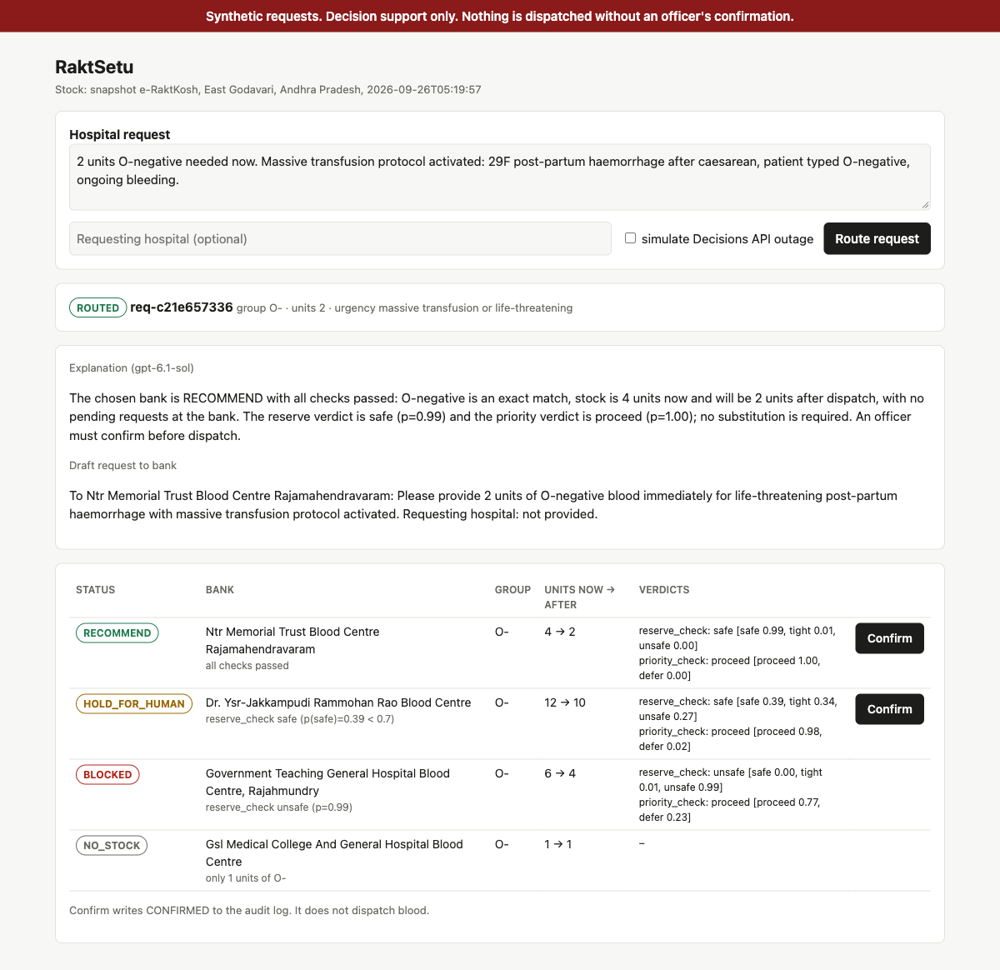

# RaktSetu

Blood request routing on live e-RaktKosh stock. The OpenAI Decisions API judges every request, code decides, and a blood bank officer confirms.

 · 123 tests (`RAKTSETU_REPLAY=1 pytest -q`) · Team: _TBD_

**Live demo:** https://raktsetu-beta.vercel.app (landing page) · [officer console](https://raktsetu-beta.vercel.app/console). It runs on live e-RaktKosh stock and is rate-limited.

Synthetic requests. Decision support only. Nothing is dispatched automatically.

**Statuses.** A request ends as `ROUTED`, `HOLD_FOR_HUMAN` or `NO_STOCK`. Each candidate bank inside it is `RECOMMEND`, `HOLD_FOR_HUMAN`, `BLOCKED` or `NO_STOCK`. A request is `ROUTED` only when at least one bank is `RECOMMEND`.

## The problem

When a mother haemorrhages after delivery, the first delay is finding the blood.

- **Searching takes hours.** In Bihar, obstetric providers estimated they wait **one to six hours** to receive blood. Three participants at a medical college without a blood bank said it takes "a minimum of two hours" to get blood from another medical college. One provider said that when blood arrives "within 3–4 hours either the patient is already dead or the doctor has already left". Source: [*The global surgery blood drought: frontline provider data on barriers and solutions in Bihar, India*, Global Health Action, 2019](https://pmc.ncbi.nlm.nih.gov/articles/PMC6493310/).
- **Issue time is separate from search time.** Once a bank has the request, issue is much faster: at Government Medical College, Trivandrum (Kerala), mean turnaround from receiving an emergency request to the blood leaving the bank was **30.9 minutes** across 125 cases. Source: conference abstract, [Asian Journal of Transfusion Science 2015;9(Suppl 1)](https://pmc.ncbi.nlm.nih.gov/articles/PMC4455105/).
- **Supply is short everywhere.** India had **2,903 blood banks** as of March 2018, and annual collection was **15% below** the requirement under the WHO norm of 1% of the population ([Factly, 2018](https://factly.in/blood-collection-increases-by-12-in-4-years-still-15-short-of-requirement)). A Lancet Haematology modelling study found that in 2017 **every country in south Asia** had insufficient blood to meet its needs ([Roberts et al., 2019](https://pubmed.ncbi.nlm.nih.gov/31631023/)).

Scarcity means a routine restock can quietly drain the O-negative that a critical patient at the same bank still needs. The context that should decide this lives in free-text notes that a stock spreadsheet cannot read.

## Before and after

RaktSetu changes the **search** step only.

| Step | Before (source) | After (measured, file) |
|---|---|---|
| Find a bank with compatible stock | 1–6 hours of calls and runners; at least 2 hours between medical colleges ([Bihar, 2019](https://pmc.ncbi.nlm.nih.gov/articles/PMC6493310/)) | All **16** banks in the district read from live e-RaktKosh in **0.88 s**. A ranked, explained recommendation in **6.3 s** p50 (n=5 live requests, Decisions API + Sol), with 166 ms p50 per Decisions API call over 30 cases ([evals/latency.json](evals/latency.json), [evals/results.md](evals/results.md)) |
| Check it is safe to take that bank's stock | Phone conversation, if at all | Per-bank reserve and priority judgments, pending-order arithmetic in code, every blocked bank shown with its reason ([src/raktsetu/policy.py](src/raktsetu/policy.py)) |
| Bank issues the blood | ~31 min mean emergency issue time ([Kerala, 2015](https://pmc.ncbi.nlm.nih.gov/articles/PMC4455105/)) | **Unchanged.** RaktSetu does not touch the bank's issue process. |
| Transport to the patient | Distance, roads, train timetables ([Bihar, 2019](https://pmc.ncbi.nlm.nih.gov/articles/PMC6493310/)) | **Unchanged.** |
| Decision to dispatch | Whoever is on the phone | **Unchanged:** a blood bank officer confirms. RaktSetu never dispatches ([src/raktsetu/api.py](src/raktsetu/api.py), `/confirm`). |

The 0.88 s and 6.3 s figures come from one live run on 10 October 2026 (`RAKTSETU_REPLAY=0 python evals/latency.py 5`). They are a small sample, not a benchmark.

## Ready to use (pilot-ready, not production-certified)

- **It reads the Health Ministry's live data.** RaktSetu calls the e-RaktKosh blood-availability API directly ([src/raktsetu/eraktkosh.py](src/raktsetu/eraktkosh.py), `fetch_live`). The live pull on 10 October 2026 returned real data: 16 banks in East Godavari, 32 bank-by-group records ([evals/latency.json](evals/latency.json)).
- **Any district e-RaktKosh covers works with no code change.** Set `ERAKTKOSH_STATE` and `ERAKTKOSH_DISTRICT` (e-RaktKosh numeric codes) in `.env`. Only East Godavari has been exercised so far.
- **Integration points:**
  - `POST /route`: request text in, ranked recommendation out.
  - `POST /confirm`: officer confirmation, written to the audit log.
  - `GET /source`: which stock data is in use.
  - `GET /`: the officer console.
  - CLI: `python -m raktsetu route --text "..."` and `python -m raktsetu demo`.
- **What it does not do yet:**
  - It does not place orders inside a blood bank's own system or move blood. The officer confirms and the existing ordering process continues.
  - It only fetches O-negative and O-positive packed red cells. Other groups are held for the officer.
  - Pending orders are synthetic, because e-RaktKosh publishes stock, not reservations.
  - The console has no authentication.

## Who uses it (viability)

Blood bank officers and hospital transfusion services. RaktSetu replaces phone calls and spreadsheet checks with a ranked, explained recommendation that the officer confirms or rejects.

Cost per request: 5.2 Decisions API calls and about 2,360 input tokens on average, which is **$0.000236 per request** at an assumed $0.10 per 1M input tokens (the rate given in the hackathon brief, set in `evals/run.py`; not independently sourced). The writer (GPT-6.1 Sol) is one more call per request and is not included in that figure. Numbers come from [evals/results.md](evals/results.md).

## Quickstart (no API key needed)

    python -m venv .venv && source .venv/bin/activate
    pip install -r requirements.txt
    RAKTSETU_REPLAY=1 python -m raktsetu demo
    RAKTSETU_REPLAY=1 pytest -q
    RAKTSETU_REPLAY=1 uvicorn raktsetu.api:app    # officer console at http://127.0.0.1:8000

Replay mode reproduces recorded model outputs; live mode (`RAKTSETU_REPLAY=0`) calls the Decisions API, Sol and e-RaktKosh. In replay mode, every Decisions API and Sol call is served from [fixtures/replay/](fixtures/replay/), recorded from live runs, with no network calls. A request that was never recorded fails with a clear error instead of guessing.

To run live, copy `.env.example` to `.env`, set `OPENAI_API_KEY`, and set `RAKTSETU_REPLAY=0`:

    python -m raktsetu route --text "2 units O-negative, massive transfusion, post-partum haemorrhage, Rajahmundry"
    python -m raktsetu demo --simulate-outage

Each run prints the stock source (`live` or `snapshot`, with a timestamp).

## Results

From [evals/results.md](evals/results.md): 30 synthetic, hand-labelled requests ([evals/cases.jsonl](evals/cases.jsonl)) run against the e-RaktKosh snapshot. Recorded live; `RAKTSETU_REPLAY=1 python evals/run.py` reproduces them.

| Metric | Value |
|---|---|
| Cases | 30 |
| Urgency accuracy (exact band of 4) | 97% |
| Urgency within one band | 100% |
| Status accuracy | 97% (29/30) |
| **Unsafe recommendations** | **0** |
| HOLD_FOR_HUMAN rate (request level) | 53% |
| Utility: ROUTED-labelled cases actually routed | 93% (13/14) |
| p50 Decisions API call latency | 165.8 ms |
| Decisions API cost per request | $0.000236 |

Holds are deliberate refusals to guess, not failures to answer. The 16 held requests break down as follows ([evals/results.md](evals/results.md)):

- 6: no bank passed the reserve, priority or substitution checks;
- 5: the blood group isn't fetched from e-RaktKosh (data coverage);
- 5: the note left the group or units missing or ambiguous.

The one miss is c19, a restock note saying the ward patients are Rh-positive. We labelled it ROUTED (O+ substitute), but the model judged the substitution uncertain and the request held. That error is in the safe direction.

How the numbers changed, in order:

1. **Unsafe c13.** The first live run had 1 unsafe recommendation: c13 routed 4 O-negative units to a bank holding exactly 4. Its reserve check said "safe" because no pending order was described there, but the dispatch would have emptied the bank. We added `min_units_after_dispatch: 1` to [policy.yaml](policy.yaml). c13's label was not changed.
2. **Whole-branch code review.** Fixes:
   - probabilities that are NaN or outside [0, 1] are now rejected;
   - snapshot-fallback stock holds instead of routing;
   - an ambiguous unit count ("1-2 units") is no longer guessed;
   - code checks that a dispatch does not leave less than the pending orders at that bank already need;
   - `substitution_ok` is asked once per request, not once per bank.
3. **Five cases relabelled.** The review also found that A, B and AB requests were routed to O substitutes only because e-RaktKosh stock for those groups is never fetched. RaktSetu now holds them for the officer instead. Cases c06, c07, c08, c12 and c17 were relabelled from ROUTED to HOLD_FOR_HUMAN for that scope change. The model answers themselves played no part in the relabel.

Demo scenarios ([data/demo_requests.json](data/demo_requests.json), `python -m raktsetu demo`):

| # | Scenario | Result |
|---|---|---|
| 1 | Massive transfusion, 2 units O-neg | Government Teaching General Hospital **BLOCKED**: reserve unsafe, plus the code check that 4 units would be left against 6 pending for a trauma case in theatre. NTR Memorial **RECOMMEND** (4 → 2). |
| 2 | Routine restock, 10 units O-neg | The only bank with 10 O-neg is **BLOCKED**: reserve unsafe and priority defer, with 8 units reserved for tomorrow's surgery. The note says the ward patients are Rh-positive, but `substitution_ok` returns p=0.44, so every O+ bank is **HOLD_FOR_HUMAN** with that one shared value. Asking the question once per request, rather than once per bank, means a single noisy answer can't be picked as the best of several. The officer decides. |
| 3 | "need blood asap pls" | **HOLD_FOR_HUMAN**. Sol writes the follow-up question: which group, how many units, what for. |
| 4 | Decisions API outage | **HOLD_FOR_HUMAN** for every bank. The audit log records the failure reason. |

## How it works

    request
     → parse group and units (code, compat.py)
     → e-RaktKosh stock, live or snapshot (eraktkosh.py)
     → Decisions API, request: urgency (score) + note_ambiguous (predicate)
     → every bank with stock of the group; too few units → NO_STOCK; units after dispatch (code)
     → groups e-RaktKosh stock is not fetched for → HOLD_FOR_HUMAN (unknown is not zero)
     → Decisions API, one call per bank, concurrent: reserve_check + priority_check (choice)
     → if no exact-group bank passes: compatible substitutes; Rh-positive substitutes need substitution_ok (predicate, asked once per request)
     → policy.yaml thresholds → RECOMMEND / HOLD_FOR_HUMAN / BLOCKED / NO_STOCK (policy.py, code)
     → ranking (code)
     → GPT-6.1 Sol writes the bank request, officer explanation and follow-up question (writer.py)
     → officer confirms (api.py /confirm) → out/audit.jsonl

Module ownership, fail-closed points and replay are described in [ARCHITECTURE.md](ARCHITECTURE.md).

Code does all arithmetic and enforces the hard limits itself: stock now, stock after dispatch, units already pending (a shortfall holds whatever the model says), never emptying a bank, ABO/Rh compatibility. The model receives those facts as text and answers typed questions ([src/raktsetu/router.py](src/raktsetu/router.py), `candidate_facts`).

## Built on OpenAI

| Product | Role | Code |
|---|---|---|
| Decisions API (`gpt-6-luna`) | Typed judgments with probabilities: urgency (score), reserve safety and priority (choice), substitution and ambiguity (predicate). Refusals are handled. | [src/raktsetu/decide.py](src/raktsetu/decide.py): `OpenAIDecider.ask`, `parse_decision` |
| GPT-6.1 Sol (Responses API, reasoning effort `low`, JSON schema output) | Writes the bank request, the officer explanation and the follow-up question. The prompt states it cannot change the decision. | [src/raktsetu/writer.py](src/raktsetu/writer.py): `SolWriter.write` |

**Why the Decisions API and not a chat completion:** answers come in fixed types that code can threshold, with a probability for every option, so `p(unsafe) >= 0.5` blocks a dispatch and `p(safe) < 0.7` holds it. If pricing is on input tokens only, as the hackathon brief states (not independently sourced), it is affordable to check every candidate bank, not just the first.

`decide.py` is the only file that knows the Decisions API wire format. The rest of the code works with `QuestionSpec` in and `Verdict` out, so another decision model can be swapped in behind the `Decider` protocol.

## Safety

- **Fails closed.** Any API error, timeout, refusal, missing answer, malformed or out-of-range number, low probability, or a failed live e-RaktKosh fetch (snapshot fallback) ends in `HOLD_FOR_HUMAN`, never `RECOMMEND`. Error text is scrubbed of key-like strings before it is logged. See [src/raktsetu/policy.py](src/raktsetu/policy.py); tests in [tests/test_router_failclosed.py](tests/test_router_failclosed.py), [tests/test_policy.py](tests/test_policy.py) and [tests/test_hardening.py](tests/test_hardening.py).
- **No automatic dispatch.** Even a `ROUTED` result needs an officer. `/confirm` only appends `CONFIRMED` to `out/audit.jsonl`, and only for a bank that the server itself returned as `RECOMMEND` or `HOLD_FOR_HUMAN`. Confirming a held bank is labelled an override in the UI and recorded with `override: true` plus the hold reasons. Each routing run has its own `decision_id` ([src/raktsetu/api.py](src/raktsetu/api.py)).
- **Blocked banks stay visible,** with the verdict that blocked them.
- **Every threshold** lives in [policy.yaml](policy.yaml).
- **Every decision is audited:** request, each candidate, raw probabilities, status, reasons, data source, model ids and latency ([src/raktsetu/audit.py](src/raktsetu/audit.py)).
- **Synthetic requests only.** Stock is real e-RaktKosh data.

## Limitations

- **Pending orders are synthetic.** They come from [data/demo_requests.json](data/demo_requests.json). e-RaktKosh publishes stock, not reservations, so a real deployment needs the bank's own order book.
- **Coverage is limited.** Only packed red cells, O-negative and O-positive, are fetched; these are the e-RaktKosh group ids verified so far. Requests for any other group are held for the officer, not routed. The default district is East Godavari, Andhra Pradesh, matching the snapshot. Other districts can be tried by setting `ERAKTKOSH_STATE` / `ERAKTKOSH_DISTRICT` (numeric e-RaktKosh codes). Coverage of any other district, including Bengaluru, is not verified.
- **No locations.** e-RaktKosh returns no coordinates, so ranking never uses distance in practice.
- **Substitution judgments are conservative.** Demo 2's note scored p=0.44 on the recorded run, so it holds. The run-to-run variance is not measured in a committed file.
- **The audit log on serverless hosts is temporary.** On Vercel it is written to `/tmp`, which is lost when the instance is recycled. A pilot needs durable storage.
- **The eval's "unsafe" check is limited and the labels are ours.** It counts ROUTED against a non-ROUTED label, a pending-order shortfall at the chosen bank, or an incompatible blood group. The labels are the authors', and 5 were relabelled (see Results).
- **No authentication on the console.** The officer name is free text. A deployment needs real sign-in.
- **The eval set is small:** 30 cases, synthetic, labelled by the authors. It shows the gates behave as intended. It is not a clinical validation.
- **Not a medical device.** RaktSetu does not replace crossmatching, blood bank SOPs or an officer's judgment.

## Next steps

- A held-out live eval on cases not used while developing.
- Cost per request including the GPT-6.1 Sol call.
- A second independent review round.

## Credits

The e-RaktKosh fetch logic and the September 2026 stock snapshot were adapted from sreeprasad/ekrakt (https://github.com/sreeprasad/ekrakt). That repository has no license file; we credit it and are seeking the author's permission.

Stock data from [e-RaktKosh](https://eraktkosh.mohfw.gov.in), Ministry of Health and Family Welfare. See [NOTICE](NOTICE).
